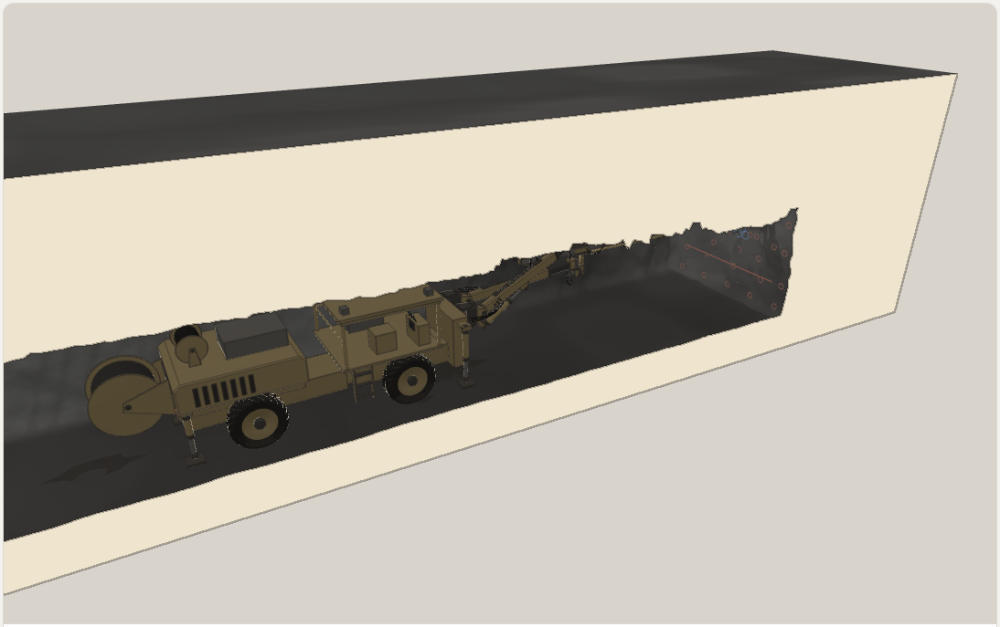

<p align="center"></p>

# Geotechnic

Skill y equipo de agentes de [Claude Code](https://claude.com/claude-code) para dibujar minería y geología **casi reales y con números verdaderos**: equipos (scoop, jumbo, camión, pala, perforadora…), taludes, macizos con fracturas, alteración, agua y polvo, labores con sostenimiento y procesos animados (perforación, voladura, carguío, dispatch). Cada escena es una sola página three.js que se publica como Artifact, en tema claro y oscuro.



## Cómo funciona

| Pieza | Qué hace |
|---|---|
| **Motor A** · equipos | Sólidos con grupos, pasadores, cilindros y mangueras; un agente por equipo mantiene sus medidas |
| **Motor B** · roca y terreno | Macizo con red de fracturas (DFN), facetas, alteración gradacional, agua y polvo; galerías, frentes y taludes |
| **Contrato** | Lo que cada motor le pasa al otro: piso, contorno, frente, huellas, polvo, taladros |
| **Juez** | Física, fidelidad (cada medida con fuente), realismo contra fotos y limpieza. Sin su aprobación no se arma la página |

**La verdad primero:** cada medida, ángulo o tiempo de una escena sale de una fuente con clave y página, o se marca *estimado*. La tabla «de dónde sale cada número» va dentro de la página.

## Instalación

```bash
git clone https://github.com/rars2021/geotechnic
cd geotechnic/.claude/skills/geotechnic
npm install          # three 0.160 para el juez
```

Requisitos: Node.js 20+, Python 3 con `numpy` y `Pillow` (realismo), Chrome o Edge (capturas del juez).

Abre Claude Code en la carpeta del repo: la skill (`.claude/skills/geotechnic`) y los agentes (`.claude/agents`) se cargan solos. Para usarla en cualquier proyecto, copia o enlaza `.claude/skills/geotechnic` a `~/.claude/skills/`.

Las fotos de referencia no vienen en el repo. Ponlas en la carpeta de la variable `GEOTECHNIC_DATOS` (por defecto `./datos`), con la estructura de [`references/fotos.md`](.claude/skills/geotechnic/references/fotos.md).

## Uso

Pídeselo a Claude con tema, escala, piezas y modo:

> Geotechnic: macizo con tres familias y una falla, escala afloramiento, modo en blanco.

> Geotechnic: dispatch de 8 camiones entre 2 palas y una chancadora, con despacho condicional.

O a mano:

```bash
cd .claude/skills/geotechnic
node scripts/juez.mjs  ejemplos/frente-jumbo --salida dist --incrustar
node scripts/armar.mjs ejemplos/frente-jumbo --salida dist --incrustar
```

Ejemplos incluidos: `talud-tajo`, `scoop-lhd`, `frente-jumbo`, `dispatch`. Guía completa en [`SKILL.md`](.claude/skills/geotechnic/SKILL.md).

## Contenido

| Carpeta | Qué hay |
|---|---|
| `.claude/skills/geotechnic/` | La skill: kit, motores, equipos, juez, ejemplos y referencias |
| `.claude/agents/` | Agentes por equipo, roca, estudio visual, escenas y juez |
| `vocabulario/` | Taxonomía de condiciones del terreno |
| `investigacion/` | Investigación sobre representación visual y rúbrica de evaluación |

## Licencia

[MIT](LICENSE) © 2026 rars2021. Incluye código de terceros con licencia MIT; ver [THIRD_PARTY_NOTICES.md](THIRD_PARTY_NOTICES.md).
